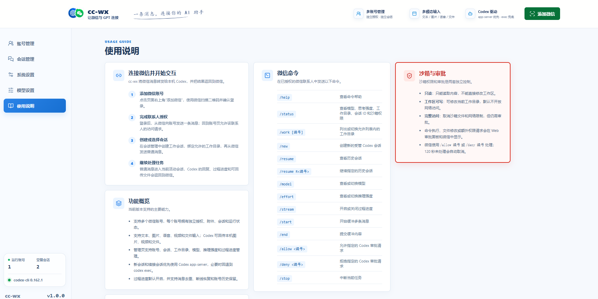
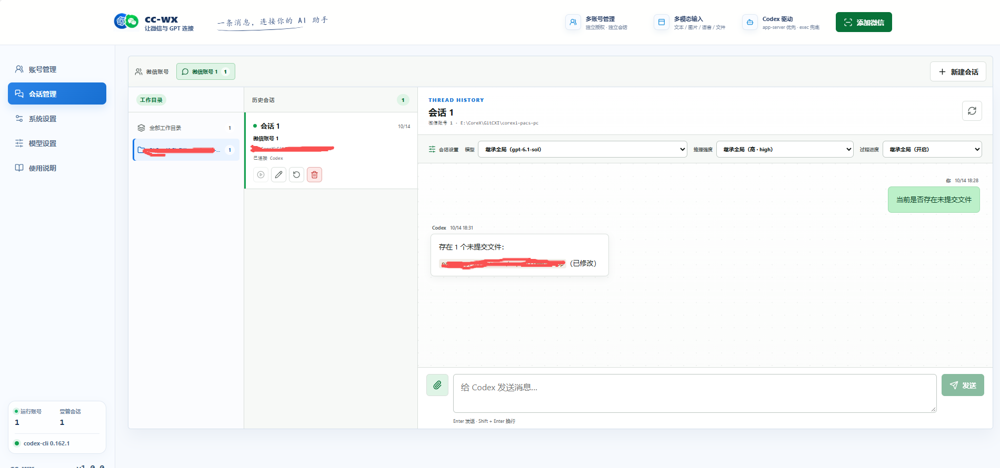

<h1 align="center">cc-wx</h1>

<p align="center">
  <strong>把个人微信账号接入本机 OpenAI Codex。</strong>
</p>

`cc-wx`（Codex Connect Weixin）是一个跨平台、本机运行的微信到 Codex 服务。启动后打开本地 Web 管理页，扫码接入微信，即可从微信私聊控制本机 Codex、管理工作目录和切换会话。

```text
微信账号 <-> cc-wx <-> 本机 Codex <-> 允许的工作目录
```

服务只监听 `127.0.0.1`，不是通用消息网关，也不会把管理页开放到局域网或公网。

## 功能概览

- 支持多个微信账号，每个账号拥有独立的授权、附件、会话和运行状态。
- 支持文本、图片、语音、视频和文件输入；Codex 可回传本机图片、视频和文件。
- Web 端提供账号、会话、工作目录、模型、推理强度和过程进度管理。
- 微信端支持 `/status`、`/new`、`/resume`、`/work`、`/model`、`/effort`、`/stream`、`/start`、`/end`、`/allow`、`/deny` 和 `/stop`。
- 新会话和续接会话优先使用 Codex app-server，必要时回退到 `codex exec`。
- 过程进度默认开启，支持消息去重、断线恢复和账号历史保留。

## 微信命令

```text
/help                         查看命令
/status                       查看会话、工作目录、thread、backend、模型和推理强度
/work                          列出允许的工作目录
/work <编号>                   切换当前会话的工作目录
/new                          创建新的受管 Codex 会话
/resume                       查看历史会话
/resume R<编号>               继续指定的历史会话
/model                        查看或切换模型
/effort                       查看或切换推理强度
/stream                       查看或切换过程进度
/start                        开始缓冲多条消息
/end                          提交缓冲内容
/allow <编号>                 允许指定的 Codex 审批请求
/deny <编号>                  拒绝指定的 Codex 审批请求
/stop                         中断当前任务
```

管理页的“系统设置”中可通过目录选择器配置默认工作目录和允许列表，允许列表最多 5 个目录。微信中发送 `/work` 查看编号，发送 `/work 1` 切换；编号无效或超出范围时会重新显示列表。切换会更新当前会话的工作目录并清除原 Codex thread，后续消息会在新目录下开始新的上下文。

普通消息进入当前活动会话。附件会保存到账号独立的入站目录，并以本地路径加入 prompt；有微信转写文本的语音优先使用转写结果。

`/start` 会开始缓冲消息，之后发送的文本和附件会暂存；发送 `/end` 后一次性提交给 Codex。`/stream on` 或 `/stream off` 控制过程进度消息；开启时，Codex 的阶段性进展会单独发送，最终答案仍单独发送。

## 沙箱与审批

系统设置中的沙箱权限有三档：

- `read-only`：只读访问，不允许直接修改工作区。
- `workspace-write`：允许修改当前工作目录，默认不开放网络访问。
- `danger-full-access`：取消沙箱文件和网络限制，应视为高风险设置。

沙箱权限和审批是两套独立控制。即使选择 `danger-full-access`，Codex 请求执行命令、修改文件或申请额外权限时仍会暂停，等待审批；完全访问不会自动跳过审批。

审批请求会出现在 Web 管理页，也会通过微信发送审批编号、命令、目录和原因。微信中使用 `/allow <编号>` 或 `/deny <编号>` 处理。审批请求只允许对应的微信发送者处理，120 秒未处理会自动取消。若需要审批但审批处理器不可用，任务会直接停止，不会降级为无审批执行。

## 启动与重启

源码开发模式：

```bash
npm run dev
```

生产模式：

```bash
npm run build
npm start
```

服务默认监听 `http://127.0.0.1:8787`。设置 `CC_WX_OPEN=0` 可禁止自动打开浏览器；设置 `CC_WX_PORT` 可更换端口。重启时先停止旧进程，再使用原启动命令重新启动；运行中的账号和配置会从 `~/.cc-wx` 恢复。

## 本地数据与安全
只接受本机绝对路径；远程 URL 不会被上传。

服务状态和默认 Codex 工作目录位于：

```text
~/.cc-wx/
  accounts/                 微信账号凭据
  retained-accounts.json    已移除账号的恢复索引
  runtime/<account-id>/     授权和会话状态
  inbound/<account-id>/     入站附件
  config.json               Codex 和工作区配置
  logs/
```

服务始终只绑定 `127.0.0.1`。启用 `danger-full-access` 前，请确认能够接受 Codex 访问整机文件的风险；该设置仍不会关闭审批。
